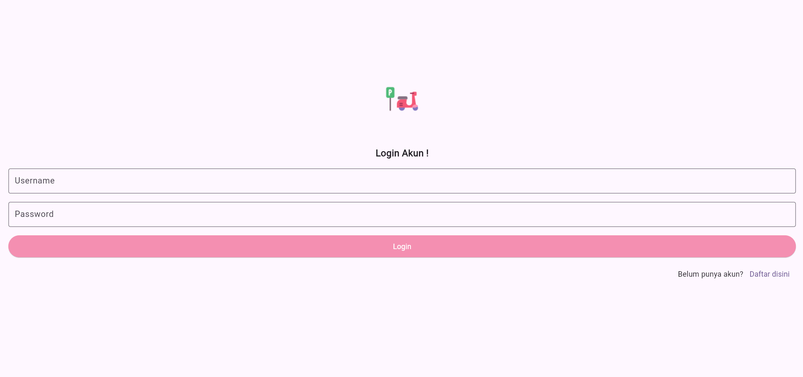
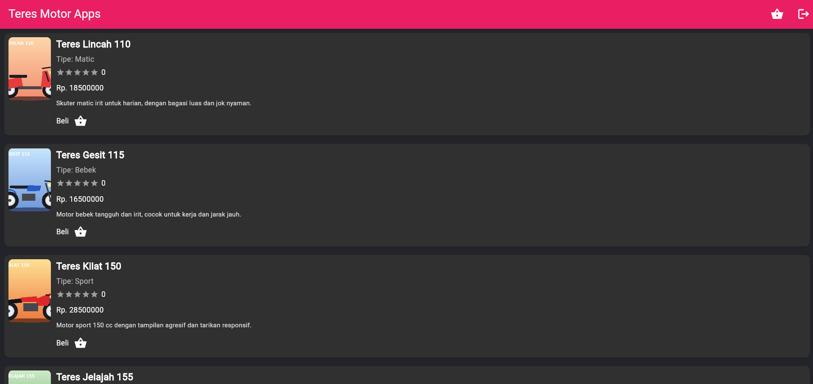
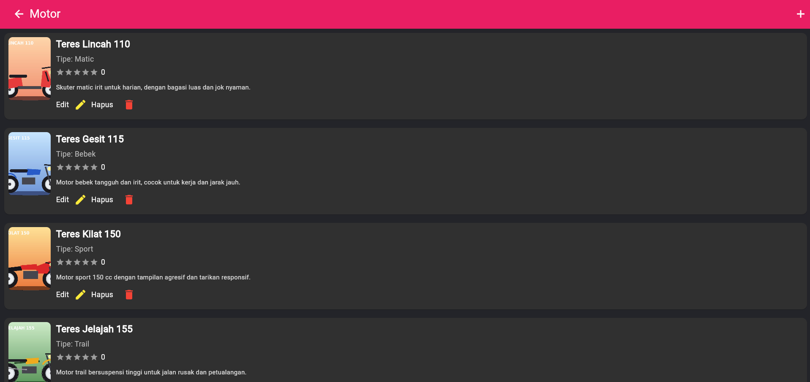
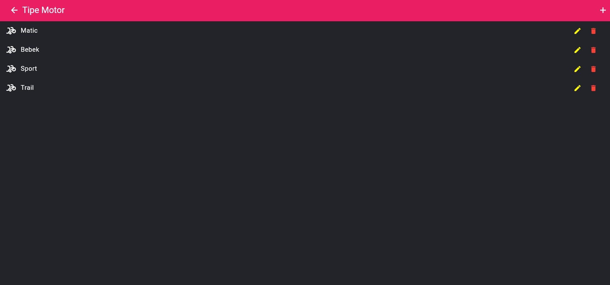
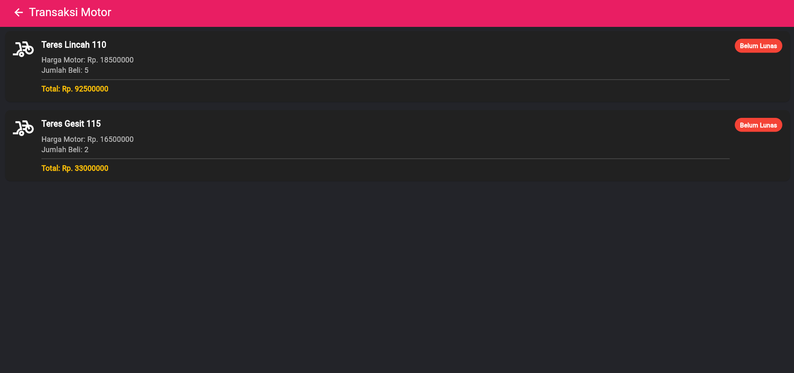
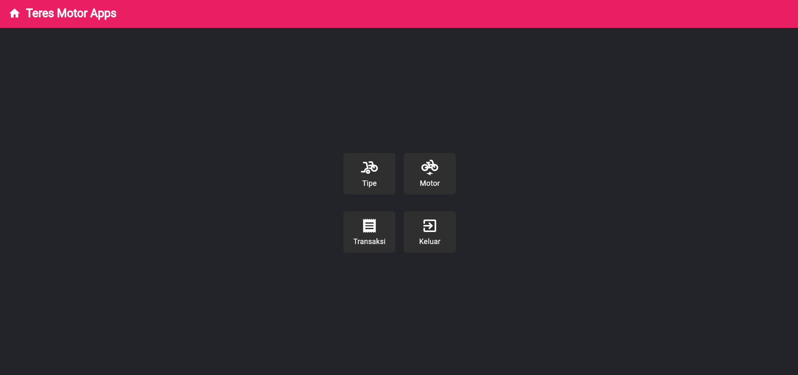

# Penjualan Motor (Mobile)

Aplikasi mobile penjualan motor yang dibuat dengan **Flutter**. Aplikasi ini adalah klien mobile dari backend [`penjualan-motor-api`](https://github.com/esterbln/penjualan-motor-api): semua data (pengguna, tipe motor, motor, pembayaran) diambil dan disimpan lewat API tersebut. Versi web dengan fungsi yang sama ada di [`penjualan-motor-frontend`](https://github.com/esterbln/penjualan-motor-frontend).

## Tampilan

| Login | Daftar Motor (User) | Daftar Motor (Admin) |
| --- | --- | --- |
|  |  |  |

| Transaksi Admin | Transaksi User |
| --- | --- |
|  |  |

| Tipe Motor | Dashboard Admin |
| --- | --- |
|  |  |

## Fitur

**Umum**
- Registrasi dan login pengguna
- Pembagian halaman berdasarkan peran (admin dan user)

**Admin**
- Kelola tipe motor (tambah, ubah, hapus)
- Kelola motor (tambah, ubah, hapus) lengkap dengan merek, harga, tipe, penilaian, keterangan, dan gambar
- Daftar pembayaran beserta konfirmasi pembayaran

**User**
- Daftar motor bergambar lengkap dengan penilaian bintang
- Membeli motor
- Riwayat pembayaran pribadi

## Teknologi

| Bagian | Yang dipakai |
| --- | --- |
| Framework | Flutter (Dart 3.4 atau lebih baru) |
| Komunikasi ke API | dio |
| Pemilih dropdown | dropdown_search |
| Unggah gambar | image_picker |
| Notifikasi dan dialog | toastification, quickalert |

## Struktur folder

```
lib/
├── api_service/api.dart   # alamat API dan daftar endpoint
├── auth/                  # halaman login dan register
├── admin/                 # beranda admin, tipe, motor, pembayaran
├── users/                 # beranda user, beli motor, pembayaran
└── main.dart              # titik masuk dan daftar route
assets/                    # gambar yang dipakai aplikasi
```

## Cara menjalankan

Aplikasi ini **membutuhkan backend yang sedang berjalan**, jadi siapkan itu dulu.

1. **Jalankan API.** Ikuti petunjuk di repo [`penjualan-motor-api`](https://github.com/esterbln/penjualan-motor-api), sampai server menyala di `http://localhost:3000`. Pastikan MySQL juga menyala.
2. **Pasang Flutter SDK**, lalu unduh atau clone repositori ini dan masuk ke foldernya.
3. **Sesuaikan alamat API** di `lib/api_service/api.dart`, pada baris `baseUrl`:
   - Chrome atau Windows: `http://localhost:3000`
   - Emulator Android: `http://10.0.2.2:3000`
   - HP asli: alamat IP laptop di jaringan Wi-Fi yang sama, misalnya `http://192.168.x.x:3000`
4. **Pasang dependensi:**
   ```
   flutter pub get
   ```
5. **Jalankan aplikasi.** Cara termudah adalah lewat Chrome:
   ```
   flutter run -d chrome
   ```

## Membuat akun

Halaman register hanya membuat akun **user biasa**. Untuk mencoba sebagai admin:

1. Daftar akun seperti biasa lewat halaman register.
2. Di database `penjualan_motor`, buka tabel `pengguna`, lalu ubah kolom `role` pada akun itu dari `2` menjadi `1` (misalnya lewat phpMyAdmin).
3. Login ulang, dan halaman admin akan terbuka.

## Urutan mencoba

1. Login sebagai admin, lalu tambah beberapa **tipe** motor.
2. Tambah beberapa **motor** (merek, harga, tipe, penilaian, keterangan, dan gambar di bawah 2 MB).
3. Logout, lalu login sebagai user dan **beli** satu motor.
4. Login lagi sebagai admin dan **konfirmasi** pembayarannya.

## Keterbatasan yang diketahui

Proyek ini adalah latihan ujian, jadi beberapa hal belum dibuat:

- Alamat API masih ditulis langsung di kode, belum memakai pengaturan lingkungan.
- Belum ada autentikasi berbasis token. Pembagian admin dan user hanya mengikuti data `role` dari respons login.
- Belum ada konfigurasi khusus untuk build rilis Android (misalnya izin internet dan lalu lintas HTTP).
- Belum ada pengujian otomatis.

## Pembuat

Ester Belen Wijaya, mahasiswa S1 Sistem Informasi, Universitas Bandar Lampung.
